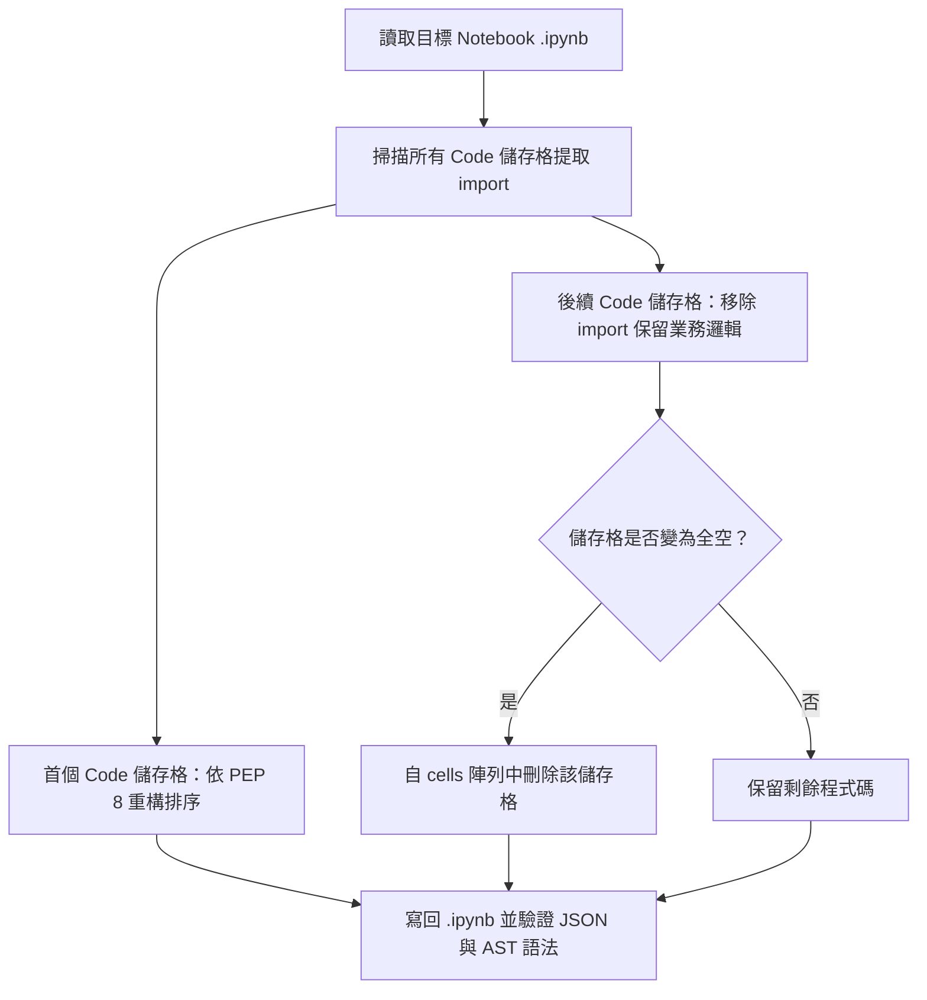

# 實作計畫：統一筆記本 Import 語句至首格

> 前置需求依據：[REQUIREMENT.md](./REQUIREMENT.md)

## 1. 目標說明 (Goal Description)
落實需求規格書定義，將專案內兩份 Jupyter 筆記本（`50-startups` 與 `boston-housing`）中分散的 `import` 語句統一匯整至各自的第一個 Code 儲存格，並按 PEP 8 規範完成分組排序與去重，同時清除移出 import 後變為全空的儲存格。

## 2. 系統架構與技術選型 (Architecture & Design)
透過讀取與更新 `.ipynb` JSON 結構執行重構，確保資料型態與 nbformat 格式完整：



### 匯入排版定義 (PEP 8)
1. **50-startups-linearregression.ipynb（首個 Code 儲存格）**：
   ```python
   from pathlib import Path

   import matplotlib.pyplot as plt
   import numpy as np
   import pandas as pd
   import seaborn as sn
   from sklearn.metrics import mean_absolute_error, mean_squared_error, r2_score
   from sklearn.model_selection import train_test_split
   from sklearn.preprocessing import MinMaxScaler, StandardScaler
   import statsmodels.api as sm
   import statsmodels.formula.api as smf
   from statsmodels.graphics.regressionplots import influence_plot
   ```
2. **boston-housing-with-linear-regression.ipynb（首個 Code 儲存格）**：
   ```python
   import matplotlib.pyplot as plt
   import numpy as np
   import pandas as pd
   import seaborn as sns
   from sklearn import metrics
   from sklearn.linear_model import LinearRegression
   from sklearn.model_selection import train_test_split

   %matplotlib inline
   ```

## 3. 需使用者審閱事項 (User Review Required)
> [!NOTE]
> - `50-startups-linearregression.ipynb`：後續儲存格（Cell 5 與 Cell 129）皆含有非 import 程式碼，抽離 import 後保留原有邏輯與註解，儲存格總數維持 161。
> - `boston-housing-with-linear-regression.ipynb`：原 Cell 22 僅包含兩行 import 語句，抽離後變為全空，將依決策直接自筆記本刪除，儲存格總數由 35 降至 34。

## 4. 檔案異動清單 (Proposed Changes)
- `[MODIFY] src/ai_infosec_dic2/50-startup-linearregression/50-startups-linearregression.ipynb`
  - 第一個 Code 儲存格（Cell 3）：彙整全部 import（加入 `Path` 與 `sm`）並按 PEP 8 排序。
  - 資料載入儲存格（Cell 5）：移除 `from pathlib import Path`，保留檔案路徑判斷與載入邏輯。
  - 模型診斷儲存格（Cell 129）：移除 `import statsmodels.api as sm`，保留 Q-Q Plot 繪圖邏輯。
- `[MODIFY] src/ai_infosec_dic2/boston-housing-linearregression/boston-housing-with-linear-regression.ipynb`
  - 第一個 Code 儲存格（Cell 2）：彙整全部 import（加入 `LinearRegression`、`train_test_split`、`metrics`）並將 `%matplotlib inline` 置於末端。
  - 模型訓練前置儲存格（Cell 22）：移出 import 後變為全空，安全刪除該儲存格。
  - 模型評估儲存格（原 Cell 27 / 刪除後變 Cell 26）：移除 `from sklearn import metrics`，保留指標輸出邏輯。

## 5. 驗證與測試計畫 (Verification Plan)
- **自動化驗證**：
  - 執行 Python 檢驗腳本，驗證兩份筆記本中：
    1. 首個 Code 儲存格包含所有預期 import 且符合 PEP 8 順序。
    2. 後續儲存格 0 處殘留任何 import 語句。
    3. 無任何空白 Code 儲存格殘留。
    4. JSON 語法結構與 Python AST 解析 100% 通過。
- **人工驗證**：
  - 開啟筆記本檢視首格版面配置，確認各圖表繪製與資料讀取程式碼邏輯無損。
