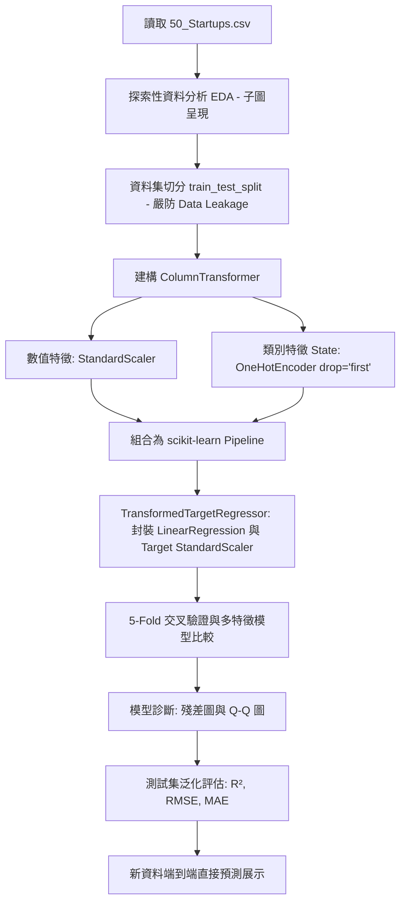

# 實作計畫：50-startups 線性迴歸筆記本之 scikit-learn Pipeline 現代化重構

> 前置需求依據：[REQUIREMENT.md](./REQUIREMENT.md)

## 1. 目標說明 (Goal Description)
本計畫旨在落實 [REQUIREMENT.md](./REQUIREMENT.md) 之要求，徹底重構 `50-startups-linearregression.ipynb`：
1. 解決原筆記本在切分資料前即呼叫 `StandardScaler.fit_transform` 造成的 **Data Leakage（資料洩漏）** 問題。
2. 導入 **scikit-learn Pipeline** 與 **ColumnTransformer**，自動化數值標準化與類別 One-Hot 編碼，並透過 `TransformedTargetRegressor` 封裝目標值 `Profit`，實現端到端自動反轉換。
3. 移除傳統 `statsmodels` 繁瑣的 OLS 報表，轉為現代機器學習工程導向之 **5-Fold 交叉驗證**、**特徵組合比較**（全特徵 vs 精簡特徵）與 **殘差診斷圖表**。
4. 將過度分散的 161 個儲存格深度整併至約 20 個結構清晰、圖文並茂的儲存格，並透過執行核心刷新圖表與指標輸出。

## 2. 系統架構與技術選型 (Architecture & Design)

### 2.1 端到端機器學習資料流 (Data Flow)



### 2.2 核心元件與介面配置
1. **集中 Import（第一個 Code 儲存格，遵循 PEP 8）**：
   ```python
   from pathlib import Path

   import matplotlib.pyplot as plt
   import numpy as np
   import pandas as pd
   import seaborn as sns
   from sklearn.compose import ColumnTransformer, TransformedTargetRegressor
   from sklearn.linear_model import LinearRegression
   from sklearn.metrics import mean_absolute_error, mean_squared_error, r2_score
   from sklearn.model_selection import KFold, cross_val_score, train_test_split
   from sklearn.pipeline import Pipeline
   from sklearn.preprocessing import OneHotEncoder, StandardScaler
   ```
2. **ColumnTransformer 設定**：
   - 數值特徵（`['R&D Spend', 'Administration', 'Marketing Spend']`）：`StandardScaler()`
   - 類別特徵（`['State']`）：`OneHotEncoder(drop='first', sparse_output=False, handle_unknown='ignore')`
3. **模型與目標變數轉換器**：
   - `TransformedTargetRegressor(regressor=LinearRegression(), transformer=StandardScaler())`
4. **模型比較實驗設計**：
   - `Full Model`：包含全數數值與類別特徵。
   - `R&D + Marketing Model`：精簡特徵組合。
   - `R&D Only Model`：單一核心驅動特徵組合。
   - 透過 5-Fold Cross Validation 計算訓練集 $R^2$ 平均值與標準差，並評估測試集 $R^2$。

### 2.3 儲存格整併架構規劃（約 20 格）
1. `[Markdown]` 筆記本標題、專案背景與重構理念說明
2. `[Code]` 集中匯入（PEP 8 規範分組）
3. `[Markdown]` 章節一：資料載入與初步探勘
4. `[Code]` 載入 CSV、檢視基本資訊、形狀、重複值與缺失值
5. `[Markdown]` 章節二：探索性資料分析 (EDA) 與視覺化
6. `[Code]` 複合子圖視覺化（數值特徵 2x2 箱形圖、2x2 分布圖與熱力相關矩陣圖）
7. `[Markdown]` 章節三：資料集切分（防止資料洩漏）
8. `[Code]` `train_test_split(test_size=0.2, random_state=42)`
9. `[Markdown]` 章節四：建立 scikit-learn Pipeline 與 ColumnTransformer
10. `[Code]` 定義前處理器與 TransformedTargetRegressor Pipeline
11. `[Markdown]` 章節五：多模型比較與 5-Fold 交叉驗證
12. `[Code]` 比較 Full Model、R&D + Marketing、R&D Only 之 CV 與 Test 表現
13. `[Markdown]` 章節六：最佳模型診斷（殘差分析與特徵權重）
14. `[Code]` 殘差散佈圖、常態 Q-Q 圖與迴歸係數分析
15. `[Markdown]` 章節七：測試集泛化能力綜合評估
16. `[Code]` 測試集預測 vs 真實值散佈圖、計算 $R^2$, RMSE, MAE
17. `[Markdown]` 章節八：端到端新樣本預測展示
18. `[Code]` 輸入全新原始特徵 DataFrame，直接調用 Pipeline 產出預測利潤
19. `[Markdown]` 結論與重構效益總結

## 3. 需使用者審閱事項 (User Review Required)
> [!IMPORTANT]
> 1. **移除 statsmodels 依賴**：本筆記本將完全移除對 `statsmodels`（如 `smf.ols`、OLS summary 報表、t 檢定報表）的依賴，全面轉向純 scikit-learn Pipeline 與現代 ML 評估標準。
> 2. **儲存格深度整併**：儲存格總數將由原先的 161 個大幅整併至約 19 個高聚合度儲存格，所有舊有的分散零碎單格將被優雅的複合子圖與流暢章節取代。
> 3. **自動反標準化**：得益於 `TransformedTargetRegressor`，所有預測與評估指標均已由 Pipeline 自動反轉為原始貨幣金額（美元），無需手動逆運算。

## 4. 檔案異動清單 (Proposed Changes)
- `[MODIFY] src/ai_infosec_dic2/50-startup-linearregression/50-startups-linearregression.ipynb`
  - 重構為現代 scikit-learn Pipeline 架構。
  - 儲存格整併並以 Python 核心執行刷新全部輸出與視覺化圖表。
- `[MODIFY] KEEP.md`
  - 新增 scikit-learn Pipeline、ColumnTransformer 與 TransformedTargetRegressor 官方最佳實踐文檔連結。

## 5. 驗證與測試計畫 (Verification Plan)
- **自動化驗證**：
  1. **語法與 PEP 8 隔離檢查**：檢查筆記本除 Cell 2 外，其餘 Code Cell import 次數為 0，且符合 Python AST 語法。
  2. **Data Leakage 驗證**：驗證 `StandardScaler` 與 `OneHotEncoder` 僅在 Pipeline fit 時對 `X_train` 擬合，無全域提前 fit。
  3. **nbformat 結構驗證**：驗證輸出為合法的 nbformat v4 JSON，且每個 Code Cell 均具備有效的 `execution_count` 與 `outputs`。
  4. **預測數值驗證**：測試集 $R^2 \ge 0.90$，新資料預測金額合理且格式正確。
- **人工驗證**：
  - 開啟 Jupyter 筆記本檢視整併後的章節排版、2x2 箱形圖、分布圖、相關係數圖、殘差分析圖與新資料預測範例。
