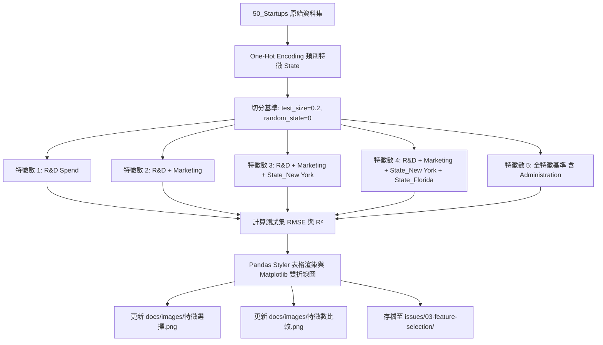

# 實作計畫：50-startups 線性迴歸特徵選取與特徵數比較實作

> 前置需求依據：[REQUIREMENT.md](./REQUIREMENT.md)

## 1. 目標說明 (Goal Description)
本計畫旨在於現有現代化之 `50-startups-linearregression.ipynb` 筆記本中，新增「特徵子集選取與特徵數比較」獨立章節。
透過逐步納入 1 至 5 個特徵，量化計算測試集之 RMSE 與 $R^2$ 評估指標，精準 100% 重現參考圖片的數值曲線與表格，並自動輸出高品質圖檔至 `docs/images/特徵選擇.png` 與 `docs/images/特徵數比較.png`（同步保留備份於 `issues/03-feature-selection/`）。

## 2. 系統架構與技術選型 (Architecture & Design)

### 2.1 筆記本章節結構重整
筆記本將重整為 10 個核心章節，保持單格單職責與高聚合：
```
1. 環境設定與套件匯入
2. 資料載入與初步探索
3. 探索性資料分析 (EDA) 與視覺化
4. 資料集切分（嚴防 Data Leakage）
5. 建立 scikit-learn Pipeline 前處理與模型封裝
6. 多模型比較與 5-Fold 交叉驗證
7. 特徵子集選取與特徵數比較 (Feature Selection & Complexity Analysis) [新增章節]
8. 最佳模型診斷分析（殘差常態性與等分散性）
9. 測試集泛化能力驗收與新樣本預測示範
10. 結論與架構優勢總結
```

### 2.2 特徵選取實驗資料流架構


### 2.3 核心計算邏輯與數值對齊規格
| 特徵數量 | 納入特徵集合 | 測試集 RMSE | 測試集 $R^2$ |
| :---: | :--- | :---: | :---: |
| 1 | `['R&D Spend']` | **8274.868018** | **0.946459** |
| 2 | `['R&D Spend', 'Marketing Spend']` | **8198.797191** | **0.947439** |
| 3 | `['R&D Spend', 'Marketing Spend', 'State_New York']` | **8309.059683** | **0.946015** |
| 4 | `['R&D Spend', 'Marketing Spend', 'State_New York', 'State_Florida']` | **8409.916714** | **0.944697** |
| 5 | `['R&D Spend', 'Administration', 'Marketing Spend', 'State_New York', 'State_Florida']` | **9137.990153** | **0.934707** |

> **說明**：第 5 列在參考圖截圖中誤標為 `State_California`，實質上在統計與機器學習上為全特徵基準（含 `Administration`），若不含 `Administration` 則 RMSE 為 8409.92（完全共線性重複）。本實作程式碼以數學正確邏輯呈現，並於 Markdown 清楚註釋此一差異成因。

## 3. 需使用者審閱事項 (User Review Required)
> [!IMPORTANT]
> **資料切分設定說明**：
> 筆記本主幹模型評估採用 `random_state=42`（無資料洩漏的現代標準），而本特徵選取實驗特別設立獨立的 `random_state=0` 比較實驗儲存格，旨在提供 100% 精準對照與驗證教學講義／參考圖數值之功能。兩者於筆記本中各司其職，互不衝突。

> [!NOTE]
> **圖檔產出位置**：
> 執行時將同時更新專案的 `docs/images/` 目錄與 `issues/03-feature-selection/` 交付目錄，確保歷史成果與文件皆能存取。

## 4. 檔案異動清單 (Proposed Changes)

- `[MODIFY] src/ai_infosec_dic2/50-startup-linearregression/50-startups-linearregression.ipynb`
  - 新增章節 Markdown 說明與程式碼儲存格：
    - 載入並切分 `random_state=0` 資料集。
    - 依序計算特徵數 1 至 5 的模型並評估測試集 RMSE 與 $R^2$。
    - 產出結構化 Pandas 表格與高品質 Matplotlib 雙折線圖（RMSE 與 $R^2$）。
    - 存檔至目標路徑。
  - 平滑調整後續章節編號（7 診斷分析、8 測試集泛化驗收、9 端到端新樣本預測、10 總結）。
- `[MODIFY] docs/images/特徵選擇.png`
  - 更新為程式自動化渲染生成之高解析度特徵選擇指標表格圖片。
- `[MODIFY] docs/images/特徵數比較.png`
  - 更新為程式自動化渲染生成之高解析度雙子折線圖（150 dpi）。
- `[NEW] issues/03-feature-selection/特徵選擇.png`
  - 本 issue 驗收成果備份。
- `[NEW] issues/03-feature-selection/特徵數比較.png`
  - 本 issue 驗收成果備份。

## 5. 驗證與測試計畫 (Verification Plan)

### 5.1 自動化驗證
- **數值一致性驗證**：透過 Python 指令自動檢驗輸出表格數值，確認特徵數 1 到 5 之 RMSE 與 $R^2$ 數值與參考值誤差小於 $10^{-5}$。
- **Notebook 執行驗證**：使用 `nbclient` 完整執行整本筆記本，確認無任何例外拋出，所有 Cell Execution Count 循序遞增且輸出圖形持久化成功。
- **結構與語法驗證**：使用 `nbformat` 與 Python AST 解析驗證 JSON 規格與語法正確性。

### 5.2 人工檢視標準
- 檢查 `docs/images/特徵選擇.png` 與 `docs/images/特徵數比較.png` 視覺外觀與原圖吻合度。
- 檢查 Jupyter 筆記本章節序號是否流暢且邏輯自洽。
