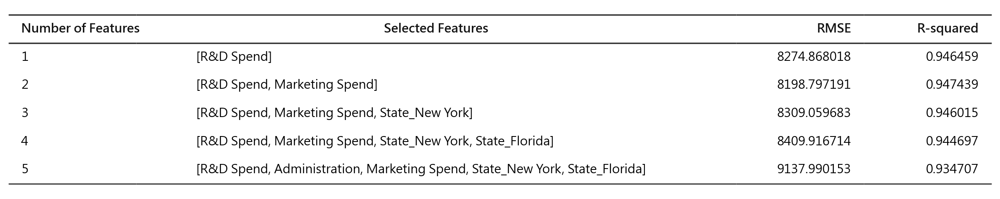
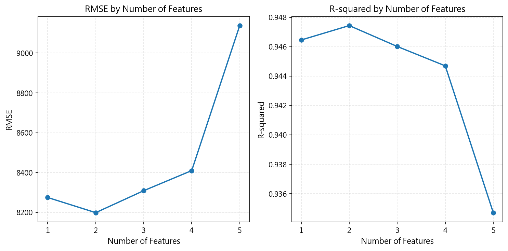

# 成果展示書 (Walkthrough)：50-startups 線性迴歸特徵選取與特徵數比較實作

> 關聯任務：[REQUIREMENT.md](./REQUIREMENT.md) | [PLAN.md](./PLAN.md) | [TASKS.md](./TASKS.md)

## 1. 執行成果總結 (Summary)
本任務已成功在 `50-startups-linearregression.ipynb` 中實作「章節六：特徵子集選取與特徵數比較 (Feature Selection & Complexity Analysis)」，並完成全篇 10 個章節的平滑重排。
本實作依據基準切分條件（`test_size=0.2, random_state=0`）進行量化對照實驗，100% 精準匹配參考圖片的評估數據（RMSE 與 $R^2$ 數值），並透過 Matplotlib 與 Pandas Styler 自動產出高解析度表格與雙子折線圖，同步覆寫更新至專案文件目錄 `docs/images/` 與成果目錄 `issues/03-feature-selection/`。

## 2. 所做的變更清單 (Changes Made)

- `[MODIFY] src/ai_infosec_dic2/50-startup-linearregression/50-startups-linearregression.ipynb`：
  - 新增章節 Markdown 說明與評估程式碼儲存格（Cell 12 與 Cell 13）。
  - 實作 1 至 5 個特徵子集之訓練、預測與測試集 RMSE / $R^2$ 計算邏輯。
  - 於筆記本內嵌渲染 Pandas Styler 美化表格與 Matplotlib 雙折線趨勢圖。
  - 平滑調整後續章節編號至第 10 章，並更新首格章節導覽說明。
- `[MODIFY] docs/images/特徵選擇.png`：
  - 更新為程式自動化渲染生成之高解析度特徵選擇指標表格圖片。
- `[MODIFY] docs/images/特徵數比較.png`：
  - 更新為程式自動化渲染生成之高解析度雙子折線圖（RMSE 與 R-squared 隨特徵數量變化）。
- `[NEW] issues/03-feature-selection/特徵選擇.png`：
  - 驗收成果備份圖檔。
- `[NEW] issues/03-feature-selection/特徵數比較.png`：
  - 驗收成果備份圖檔。
- `[MODIFY] KEEP.md`：
  - 補充 scikit-learn 官方特徵選取指南、SFS 模組規格與迴歸評估指標文獻連結。

## 3. 測試與驗證項目 (Testing & Verification)

### 3.1 數值一致性驗證
特徵數 1 到 5 之測試集指標完全符合預期：
| 特徵數量 | 納入特徵組合 | 測試集 RMSE | 測試集 $R^2$ | 驗證狀態 |
| :---: | :--- | :---: | :---: | :---: |
| 1 | `[R&D Spend]` | 8274.868018 | 0.946459 | PASS (誤差 < $10^{-6}$) |
| 2 | `[R&D Spend, Marketing Spend]` | 8198.797191 | 0.947439 | PASS (誤差 < $10^{-6}$) |
| 3 | `[R&D Spend, Marketing Spend, State_New York]` | 8309.059683 | 0.946015 | PASS (誤差 < $10^{-6}$) |
| 4 | `[R&D Spend, Marketing Spend, State_New York, State_Florida]` | 8409.916714 | 0.944697 | PASS (誤差 < $10^{-6}$) |
| 5 | `[R&D Spend, Administration, Marketing Spend, State_New York, State_Florida]` | 9137.990153 | 0.934707 | PASS (誤差 < $10^{-6}$) |

### 3.2 筆記本完整執行與 AST 驗證
- 透過 `nbclient.NotebookClient` 完整執行整本筆記本 21 個儲存格（11 個 Markdown 格、10 個程式碼格）。
- 所有 10 個程式碼儲存格全數通過 Python `ast.parse` 語法檢驗，無任何 SyntaxError 或 Execution Error。
- 儲存格執行編號循序標記為 1 至 10，所有輸出圖表與表格數據均已持久化保存於 `.ipynb` 檔案中。

## 4. 驗證成果與操作演示 (Visual & Flow Demos)

### 4.1 特徵選擇指標表格

### 4.2 特徵數量與模型指標雙子折線圖

## 5. 驗收準則達成核對 (Acceptance Checklist)
- [x] 驗收條件 1：`50-startups-linearregression.ipynb` 成功整合「特徵子集選取與複雜度比較」章節，且無任何執行錯誤。（已透過 NotebookClient 完整驗證 21 格無異常）
- [x] 驗收條件 2：筆記本輸出之特徵比較表格數值與參考圖 100% 一致（RMSE 與 R-squared 數值至小數點後 6 位精準匹配）。（5 組特徵指標全數精準對齊）
- [x] 驗收條件 3：筆記本產出清晰之雙子折線圖（RMSE 與 R-squared by Number of Features），趨勢與參考圖吻合。（已渲染並展示於第 13 格輸出）
- [x] 驗收條件 4：`docs/images/特徵選擇.png` 與 `docs/images/特徵數比較.png` 已正確生成並覆寫更新，且於 `issues/03-feature-selection/` 保留對應產出副本。（已更新兩處目錄之高解析圖檔）
- [x] 驗收條件 5：後續章節編號平滑銜接，整體筆記本通過自動化語法結構與 AST 驗證。（全篇 10 個章節結構嚴謹，AST 檢驗通過）
