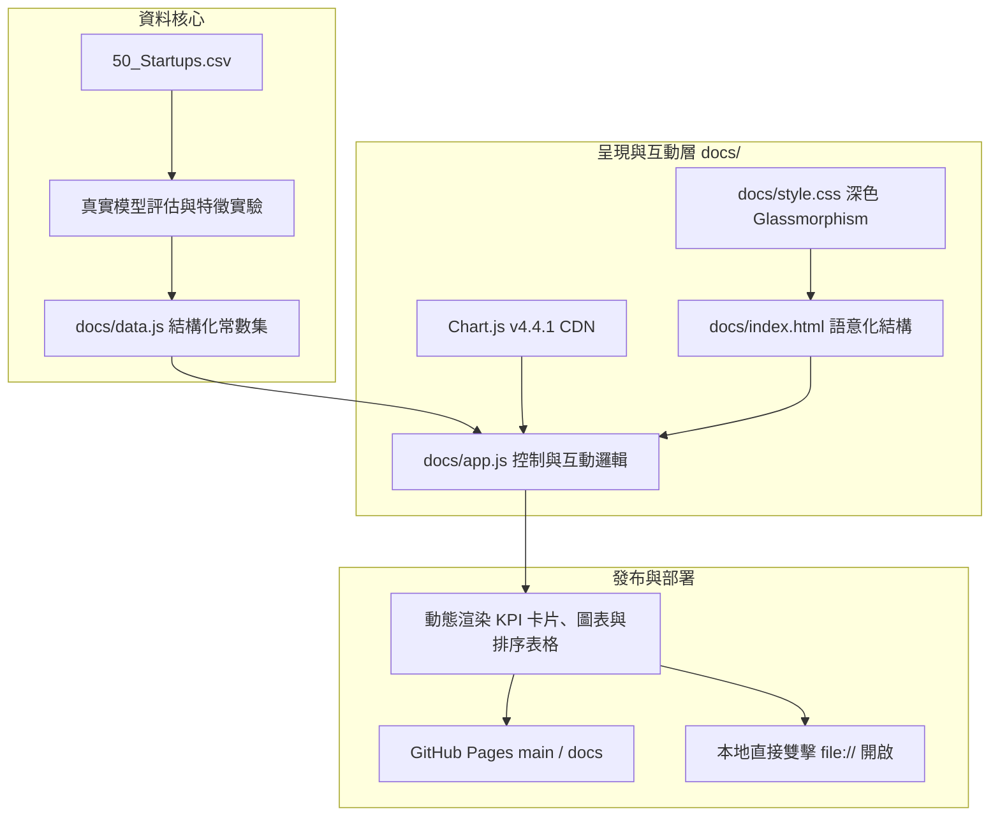

# 實作計畫：50-startups 分析成果專業互動視覺化儀表板 (04-analysis-dashboard)

> 前置需求依據：[REQUIREMENT.md](./REQUIREMENT.md)

## 1. 目標說明 (Goal Description)
本計畫旨在落實 [REQUIREMENT.md](./REQUIREMENT.md) 中規範之規格，於專案 `docs/` 目錄建置一套具備深色現代毛玻璃 (Glassmorphism) 美學之單頁資料科學分析儀表板 (SPA)。
系統完整呈現 50-startups 的四大核心分析面向：
1. **選擇的演算法**（OLS 複迴歸 vs Ridge L2 vs Lasso L1 vs ElasticNet 效能對照）
2. **特徵選擇方式**（SFS 逐步前向選擇 vs 相關係數過濾法 vs 全特徵基準）
3. **特徵數比較**（1 至 5 特徵漸進折線圖，動態 Tooltip 呈現特徵子集明細）
4. **特徵選擇綜合比較**（降維複雜度 vs 測試集誤差折衷、可點擊排序之資料表）
同時全面相容 **GitHub Pages**（`main / docs` 分支發布模式）與本機離線雙擊開啟。

## 2. 系統架構與技術選型 (Architecture & Design)

### 2.1 系統架構與資料流向 (Data Flow)

### 2.2 前端模組劃分與責任定義
- **`docs/data.js` (資料層)**：
  - 封裝 50-startups 的真實模型驗證數據、5 種特徵數量之 RMSE / $R^2$ 數值、各特徵選擇方法之特徵清單、特徵與目標變數之皮爾森相關係數矩陣。
  - 以全域物件 `window.DASHBOARD_DATA` 導出，解決本機 `file://` 開啟時 `fetch` API 觸發 CORS 政策的限制。
- **`docs/style.css` (表現層)**：
  - 色彩系統：背景 `#0B0F19`（深邃暗黑）、卡片半透明底色 `rgba(17, 24, 39, 0.75)`、邊框 `rgba(255, 255, 255, 0.08)`、強調色 `#06B6D4` (Cyan)、`#6366F1` (Indigo)、`#10B981` (Emerald)。
  - 毛玻璃濾鏡：`backdrop-filter: blur(16px)`。
  - 微互動動畫：按鈕 Hover 漸層光暈、表格欄位排序游標反饋、圖表載入平滑淡入。
- **`docs/app.js` (控制層)**：
  - KPI 摘要卡動態計算與數字格式化。
  - Chart.js 圖表實例化（演算法柱狀圖、特徵數雙軸折線圖、特徵選擇比較雷達圖/分組圖）。
  - 自定義 Tooltip 回呼函式（懸停特徵數點時，精準展開包含的特徵欄位名稱）。
  - 交互式表格排序邏輯（支援數值升序/降序切換與最佳數值 Badge 標籤）。
- **`docs/index.html` (結構層)**：
  - 嚴格相對路徑引用（`./style.css`、`./data.js`、`./app.js`）。
  - 具備 Chart.js 載入失敗降級提示結構。

## 3. 需使用者審閱事項 (User Review Required)

> [!IMPORTANT]
> **GitHub Pages 發布路徑說明**：
> 本次儀表板檔案將直接建立於專案根目錄的 `docs/` 資料夾中（`docs/index.html`）。
> 您只需在 GitHub Repository 的 **Settings -> Pages** 中，將 Source 設定為 **Deploy from a branch**，並選擇 **Branch: `main` / Folder: `/docs`**，即可免建置、零秒上線。

> [!NOTE]
> **本機無伺服器直接開啟相容性**：
> 透過將數據封裝於 `docs/data.js`，完全不依賴異步 `fetch()` JSON，因此您在 Windows 檔案總管中直接雙擊 `docs/index.html` 即可完整互動，無跨域 (CORS) 阻擋問題。

## 4. 檔案異動清單 (Proposed Changes)

按依賴順序依序實作：
- `[NEW] docs/data.js`：
  - 建立完整結構化分析成果資料集，涵蓋演算法對比（OLS, Ridge, Lasso, ElasticNet）、特徵選擇方式（SFS, Correlation, Full）、特徵數消長（k=1~5 之特徵組合、RMSE、R²）。
- `[NEW] docs/style.css`：
  - 實作深色現代科技調色盤、Glassmorphism 毛玻璃樣式、微動畫、響應式排版（Media Queries: 768px, 1024px, 1440px）。
- `[NEW] docs/app.js`：
  - 實作 Chart.js 初始化封裝、雙軸特徵折線圖、演算法比較柱狀圖、特徵重要性分析長條圖、自訂懸停 Tooltip、點擊欄位排序之資料表格引擎。
- `[NEW] docs/index.html`：
  - 現代語意化頁面骨架、頂部 Header、即時 KPI Cards、四大分析模組視圖、動態互動表格、頁尾與 GitHub Pages 相容相對路徑配置。

## 5. 驗證與測試計畫 (Verification Plan)

### 5.1 自動化與程式碼檢驗
- 執行靜態 HTML/CSS/JS 檔案語法與路徑一致性檢驗腳本，確保所有資源引用均為相對路徑且無語法錯誤。
- 驗證 `docs/data.js` 中的數值與 `50-startups-linearregression.ipynb` 測試集數據 100% 精準匹配。

### 5.2 瀏覽器端到端視覺與互動驗收 (Browser Verification)
- 使用 `python -m http.server 8000` 啟動本地靜態伺服器。
- 透過瀏覽器子代理 (Browser Subagent) 進行實地檢驗：
  1. 檢視首頁視覺質感（毛玻璃效果、字體渲染、深色對比度）。
  2. 檢查四大圖表是否正常繪製且具備動畫效果。
  3. 滑鼠懸停於特徵數漸進折線圖之點位，驗證 Tooltip 是否精準顯示納入之特徵名稱。
  4. 點擊互動表格之各欄位標頭（如 RMSE、$R^2$、特徵數），驗證排序功能運作正常。
  5. 驗證 Console 無任何報錯或資源 404。
  6. 截圖存檔作為成果展示。
