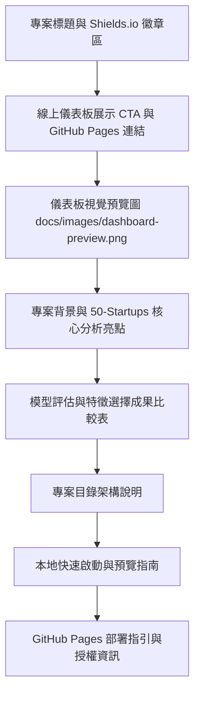

# 實作計畫：README 專案說明與互動儀表板展示整合 (05-readme-dashboard-showcase)

> 前置需求依據：[REQUIREMENT.md](./REQUIREMENT.md)

## 1. 目標說明 (Goal Description)
本計畫旨在將目前為空的專案根目錄 [README.md](../../README.md) 建置為專業、美觀且資訊完整的機器學習專案門面。計畫重點包含：
1. 建立真實動態渲染之儀表板預覽圖 (`docs/images/dashboard-preview.png`)。
2. 於 [README.md](../../README.md) 整合 GitHub Pages 線上展示連結、動態 Shields.io 狀態徽章與 Call-to-Action 視覺引導。
3. 精準摘要 50-Startups 演算法評估指標（OLS、Ridge、Lasso、ElasticNet）與特徵選擇消長發現（最佳 2 特徵子集：`R&D Spend` + `Marketing Spend`）。
4. 提供清晰的專案檔案結構導覽、本地離線/HTTP 伺服器啟動方式，以及 GitHub Pages 部署啟用指南。

## 2. 系統架構與技術選型 (Architecture & Design)

### 2.1 README 模組結構設計

### 2.2 預覽截圖生成策略
- 利用本機安裝之 Headless Chrome / Edge 瀏覽器，渲染 `docs/index.html`。
- 設定視窗尺寸為標準桌面高解析寬度（1440x900），確保 Chart.js 圖表動畫、KPI 卡片與毛玻璃特效完整呈現。
- 輸出圖檔儲存至 `docs/images/dashboard-preview.png`，並透過 Markdown 相對路徑 `docs/images/dashboard-preview.png` 於 README 引用。

### 2.3 核心數據精確匹配對照
所有呈現在 README 的評估數據均須嚴格同步自 [docs/data.js](../../docs/data.js) 與 [WALKTHROUGH.md](../04-analysis-dashboard/WALKTHROUGH.md)：
- **特徵選擇最優子集**：2 特徵 (`R&D Spend`, `Marketing Spend`)，測試集 $R^2 = 0.947439$，$\text{RMSE} = 8198.80$。
- **演算法比較基準**：全特徵 (5 特徵) 多元線性迴歸 $R^2 = 0.934707$，$\text{RMSE} = 9137.99$；經 SFS 特徵篩選後預測效能全面提升。

## 3. 需使用者審閱事項 (User Review Required)

> [!IMPORTANT]
> **GitHub Pages 部署路徑確認**
> 線上網址配置為：`https://chenglianghsu.github.io/AI-InfoSec-DIC2/`。
> 若 GitHub 遠端儲存庫尚未開啟 Pages 功能，需至儲存庫 **Settings -> Pages**，在 **Build and deployment** 下選擇 **Deploy from a branch**，分支設定為 `master` (或 `main`)、資料夾選擇 `/docs` 即可自動上線。

> [!NOTE]
> **圖片相對路徑規範**
> 預覽截圖將儲存於 `docs/images/dashboard-preview.png`，使用標準相對路徑。無論是在 GitHub Web 介面瀏覽或是下載至本地 Clone，圖片皆可正常顯示。

## 4. 檔案異動清單 (Proposed Changes)

- `[NEW] docs/images/dashboard-preview.png`：
  - 由瀏覽器自動渲染並擷取之深色毛玻璃儀表板高解析度外觀圖。
- `[MODIFY] README.md`：
  - 從空白檔案建置完整專案門面內容，包含徽章、Live Demo 連結、截圖嵌入、核心數據對照表、架構導覽、本地啟動指令與 Pages 設定指引。

## 5. 驗證與測試計畫 (Verification Plan)

### 5.1 自動化驗證
- 驗證 `docs/images/dashboard-preview.png` 檔案確實存在且大小合理（大於 50KB 且小於 2MB）。
- 驗證 [README.md](../../README.md) 中所有相對檔案連結皆指向專案內實際存在之路徑。
- 驗證 [README.md](../../README.md) 提及之指標數值與 [docs/data.js](../../docs/data.js) 完全精準一致。

### 5.2 人工驗收步驟
1. 開啟 [README.md](../../README.md)，檢視 Markdown 格式是否美觀排版無破綻。
2. 點擊儀表板截圖與 Live Demo 連結，確認連結指向 `https://chenglianghsu.github.io/AI-InfoSec-DIC2/`。
3. 檢查本地啟動指令（如 `python -m http.server 8000 --directory docs`）是否清晰可行。
