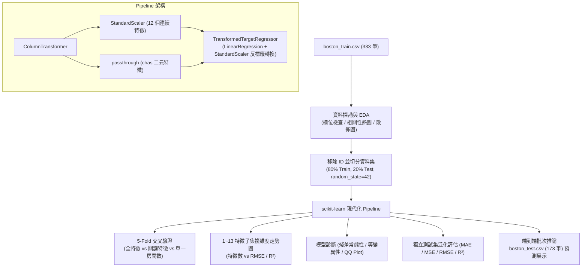

# 實作計畫：Boston Housing 線性迴歸筆記本現代化重構 (06-boston-housing-refactor)

> 前置需求依據：[REQUIREMENT.md](./REQUIREMENT.md)

## 1. 目標說明 (Goal Description)
本計畫旨在將 `50-startups-linearregression.ipynb` 的現代化機器學習工程標準完全移植並深植於 `boston-housing-with-linear-regression.ipynb`。全面解決原筆記本寫死 Kaggle 路徑、未分流特徵標準化、無 Pipeline 封裝、缺乏交叉驗證與特徵複雜度分析等問題，交付一份具備零資料洩漏、10 章節完整架構、並預先執行內嵌豐富視覺化與輸出成果的高品質教學筆記本。

## 2. 系統架構與技術選型 (Architecture & Design)

### 2.1 系統架構流程圖

### 2.2 筆記本 10 大章節規劃
1. **資料載入與初步探勘**：動態定位檔案路徑，檢視 15 欄位維度、缺失值與敘述統計。
2. **探索性資料分析 (EDA) 與視覺化**：相關性熱圖（標示與 `medv` 相關度）、`medv` 價格分佈直方圖、`rm` 與 `lstat` 核心散佈圖。
3. **資料集切分（嚴防資料洩漏）**：排除 `ID`，以 80/20 比例建立獨立訓練集與測試集。
4. **建立 scikit-learn Pipeline 前處理與模型封裝**：`ColumnTransformer` 分流處理 12 個連續特徵與 1 個二元特徵 `chas`，搭配 `TransformedTargetRegressor`。
5. **多模型比較與 5-Fold 交叉驗證**：比較「全特徵 (13)」、「關鍵特徵 (`rm`, `lstat`, `ptratio`)」、「單一房間數 (`rm`)」之 CV 表現。
6. **特徵子集選取與複雜度分析**：依相關性排序逐步納入 1 至 13 個特徵，繪製特徵數對應之 RMSE 與 $R^2$ 曲線。
7. **模型診斷分析**：殘差直方圖與 KDE、殘差對預測值散佈圖、常態 Q-Q 圖。
8. **測試集泛化能力綜合評估**：計算 MAE, MSE, RMSE, $R^2$ 並換算千美元尺度，解析標準化迴歸係數。
9. **端到端無標籤推論展示**：載入 `boston_test.csv` (173 筆) 進行直接推論，產出預測摘要與範例。
10. **結論與重構效益總結**：總結 5 大架構亮點與工程實踐價值。

## 3. 需使用者審閱事項 (User Review Required)

> [!IMPORTANT]
> - **Python 環境選用**：本機全域 Python 未安裝機器學習套件，執行與驗證將採用已配置完整依賴（scikit-learn 1.2.2、matplotlib、seaborn、pandas、nbclient）之 Anaconda 環境（`C:\Users\amath701\anaconda3\python.exe`）。
> - **路徑自動適配**：原寫死之 `../input/boston_train.csv` 將替換為基於當前筆記本所在目錄之動態路徑，確保於任何 IDE 或命令列均能即開即跑。

## 4. 檔案異動清單 (Proposed Changes)
- `[MODIFY] src/ai_infosec_dic2/boston-housing-linearregression/boston-housing-with-linear-regression.ipynb`：全面重構為現代化 10 章節架構，並由核心執行完畢填入完整 outputs。
- `[NEW] src/ai_infosec_dic2/boston-housing-linearregression/test_boston_notebook.py`（輔助驗證腳本，驗證完後可保留或納入測試）：自動化載入並驗證筆記本執行成功率與各指標計算正確性。

## 5. 驗證與測試計畫 (Verification Plan)
- **自動化執行與單元驗證**：
  - 執行指令：`C:\Users\amath701\anaconda3\python.exe -m nbclient.cli src/ai_infosec_dic2/boston-housing-linearregression/boston-housing-with-linear-regression.ipynb`（或專屬腳本）
  - 驗收準則：所有單元格無任何 `ename` / `error` 輸出，圖表輸出均為合法 base64 PNG，評估指標數值正確產出。
- **人工驗證步驟**：
  - 開啟重構後之 `.ipynb`，檢查各章節 Markdown 說明清晰完整、中文字型顯示無方框亂碼、三組模型交叉驗證與特徵走勢圖渲染正常。
