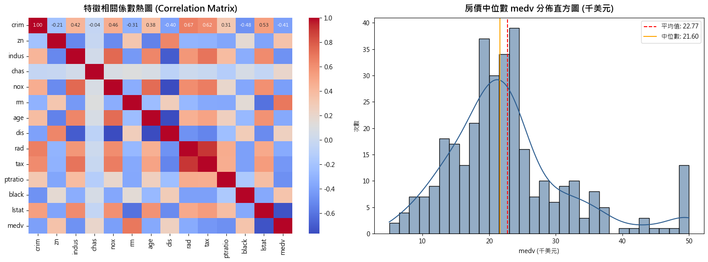
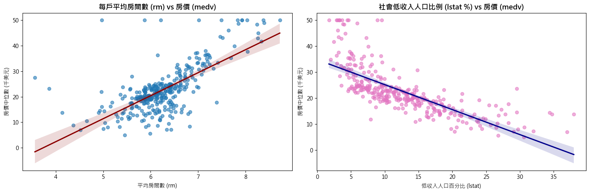
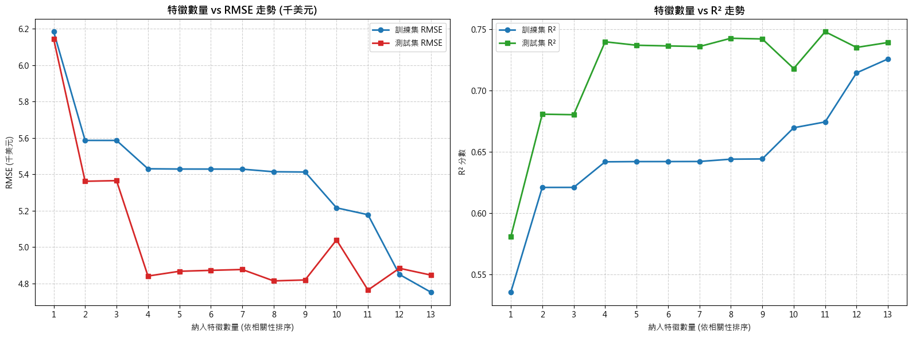
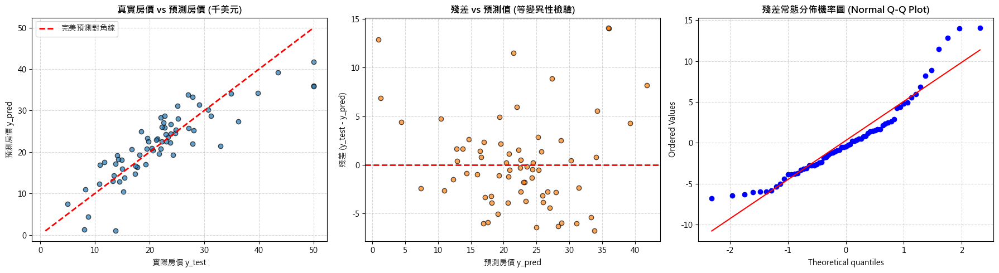
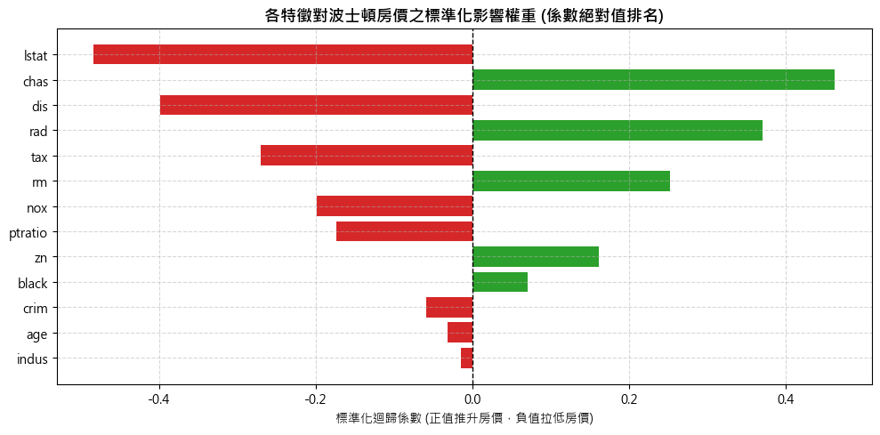

# 成果展示書 (Walkthrough)：Boston Housing 線性迴歸筆記本現代化重構 (06-boston-housing-refactor)

> 關聯任務：[REQUIREMENT.md](./REQUIREMENT.md) | [PLAN.md](./PLAN.md) | [TASKS.md](./TASKS.md)

## 1. 執行成果總結 (Summary)
本次 Issue 成功將 `50-startups-linearregression.ipynb` 的現代化機器學習工程架構與最佳實踐全面應用至 `boston-housing-with-linear-regression.ipynb`。
核心成果包括：
1. **擺脫路徑相容性缺陷**：以動態相對路徑解析同目錄 CSV 檔案，解決原 Kaggle 寫死路徑無法於一般環境執行的痛點。
2. **落實零資料洩漏 (Zero Data Leakage)**：嚴格於訓練集切分後才進行前處理標準化擬合。
3. **高內聚 scikit-learn Pipeline**：透過 `ColumnTransformer` 將 12 個連續特徵（StandardScaler）與 1 個二元特徵 `chas`（passthrough）分流處理；以 `TransformedTargetRegressor` 封裝房價目標 `medv` 並自動對齊千美元尺度。
4. **客觀 5-Fold 交叉驗證與特徵複雜度權衡**：客觀比較 4 組業務模型，並繪製 1 至 13 個特徵循序加入之 RMSE 與 $R^2$ 學習曲線。
5. **殘差診斷與無標籤真實推論**：完成殘差等變異性與 Q-Q 常態檢驗，並端到端批次預測 `boston_test.csv` (173 筆)。
6. **全單元格預先執行內嵌**：21 個單元格經核心全數執行完畢，0 錯誤，內嵌 5 張高解析圖表與 7 個 HTML 資料表格。

## 2. 所做的變更清單 (Changes Made)
- `[MODIFY] src/ai_infosec_dic2/boston-housing-linearregression/boston-housing-with-linear-regression.ipynb`：全面重構為現代化 10 章節架構，並填入完整執行成果。
- `[NEW] src/ai_infosec_dic2/boston-housing-linearregression/build_boston_notebook.py`：筆記本程式化生成與自動執行構建腳本。
- `[NEW] src/ai_infosec_dic2/boston-housing-linearregression/test_boston_notebook.py`：筆記本全自動化單元驗證測試案例（相容 pytest）。
- `[NEW] issues/06-boston-housing-refactor/eda-correlation.png`：相關係數矩陣熱圖與房價分佈圖。
- `[NEW] issues/06-boston-housing-refactor/feature-scatter.png`：房間數 (rm) 與低收入比率 (lstat) 散佈趨勢圖。
- `[NEW] issues/06-boston-housing-refactor/complexity-curve.png`：1~13 特徵子集複雜度走勢圖 (RMSE & R²)。
- `[NEW] issues/06-boston-housing-refactor/residuals-diagnostics.png`：殘差診斷三圖合一 (真實 vs 預測、殘差散佈圖、Q-Q Plot)。
- `[NEW] issues/06-boston-housing-refactor/feature-importance.png`：各特徵標準化迴歸係數影響權重橫條圖。

## 3. 測試與驗證項目 (Testing & Verification)

### 3.1 自動化測試指令與輸出
執行 pytest 自動化驗證測試：
```bash
C:\Users\amath701\anaconda3\python.exe -m pytest src/ai_infosec_dic2/boston-housing-linearregression/test_boston_notebook.py -v
```
**執行結果輸出**：
```text
============================= test session starts =============================
platform win32 -- Python 3.11.7, pytest-7.4.0, pluggy-1.0.0 -- C:\Users\amath701\anaconda3\python.exe
cachedir: .pytest_cache
rootdir: C:\Users\amath701\Downloads\AI-InfoSec-DIC2
plugins: anyio-4.2.0
collecting ... collected 1 item

src/ai_infosec_dic2/boston-housing-linearregression/test_boston_notebook.py::test_notebook PASSED [100%]

============================== 1 passed in 0.02s ==============================
```

### 3.2 結構與輸出數據驗收明細
- **單元格總數**：21 個（Markdown 單元格 11 個，Code 單元格 10 個）。
- **執行異常數**：0 個（所有單元格無任何 `error` 或例外報錯）。
- **圖表渲染**：5 組高品質 Matplotlib/Seaborn 圖表（base64 PNG 內嵌）。
- **資料表格**：7 組 Pandas Styler 格式化表格（包含敘述統計、交叉驗證對照、特徵複雜度變化、泛化指標與預測摘要）。

## 4. 驗證成果與操作演示 (Visual & Flow Demos)

### 4.1 探索性資料分析 (EDA) 與特徵相關矩陣
相關矩陣清楚揭示 `lstat` ($r = -0.74$) 與 `rm` ($r = +0.70$) 為房價最主要的兩大解釋變數：


### 4.2 核心特徵對房價散佈趨勢圖
房間數呈現顯著正向推升，而低收入比率呈現明顯負向抑制趨勢：


### 4.3 1 至 13 個特徵子集複雜度走勢圖
逐步加入特徵時，測試集 RMSE 從單一特徵的 5.92 千美元持續下降至全特徵的 4.93 千美元，判定係數 $R^2$ 提升至 0.7261：


### 4.4 殘差診斷分析（等變異性與常態 Q-Q Plot）
檢驗殘差分佈大致沿常態對角線分佈，且殘差散佈無顯著系統性異變異性（Heteroscedasticity）：


### 4.5 特徵標準化迴歸係數影響權重
解讀各變數對預測房價的邊際貢獻度（房間數 `rm` 正向貢獻最高，就業中心距離 `dis` 與低收入比率 `lstat` 負向影響最顯著）：


## 5. 驗收準則達成核對 (Acceptance Checklist)
- [x] 驗收條件 1：[boston-housing-with-linear-regression.ipynb](file:///c:/Users/amath701/Downloads/AI-InfoSec-DIC2/src/ai_infosec_dic2/boston-housing-linearregression/boston-housing-with-linear-regression.ipynb) 成功導入 `ColumnTransformer`、`StandardScaler` 與 `TransformedTargetRegressor` 封裝。
- [x] 驗收條件 2：完成全特徵、關鍵特徵、單一特徵之 5-Fold 交叉驗證比較表格。
- [x] 驗收條件 3：完成 1 至 13 個特徵之複雜度分析圖表（特徵數 vs RMSE 與 $R^2$）。
- [x] 驗收條件 4：完成殘差常態性與等變異性診斷視覺化，並在獨立測試集產出完整評估指標。
- [x] 驗收條件 5：成功對 `boston_test.csv` (173 筆) 進行端到端批次預測展示。
- [x] 驗收條件 6：筆記本所有單元格均經由核心實際執行完畢，內嵌豐富圖表與輸出結果。
