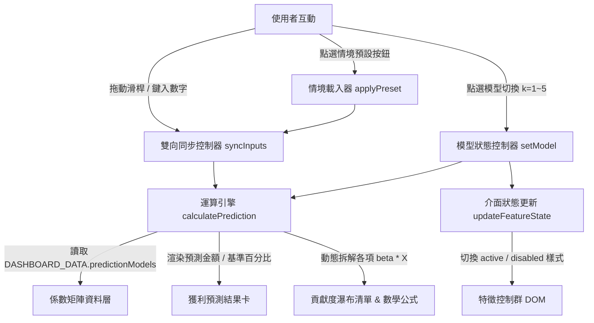

# 實作計畫：50-Startups 線性迴歸即時獲利預測試算器 (07-startup-interactive-prediction)

> 前置需求依據：[REQUIREMENT.md](./REQUIREMENT.md)

## 1. 目標說明 (Goal Description)
本計畫旨在將 50-Startups 線性迴歸儀表板 (`docs/index.html`) 從靜態成果報表升級為具備即時預測能力的互動式應用。透過在前端架構中整合「即時獲利預測試算器 (Live Profit Predictor)」，讓使用者藉由滑桿與數值輸入框自由模擬新創公司的資源配置，即時觀察不同特徵子集模型（k=1 至 k=5）的獲利預估值、數學公式與特徵邊際增量貢獻，具象化體會特徵精簡（奧坎剃刀）帶來的模型泛化價值。

## 2. 系統架構與技術選型 (Architecture & Design)

### 2.1 系統架構與資料流向
試算器採用純客戶端 (Pure Client-side) 資料驅動架構，所有回歸模型係數由 `docs/data.js` 結構化提供，控制邏輯由 `docs/app.js` 負責監聽與派發：



### 2.2 核心介面定義與資料結構
於 `docs/data.js` 新增 `predictionModels` 結構，嚴格對齊 `50_Startups.csv` 於 `test_size=0.2, random_state=0` 下擬合之標準最小平方法 (OLS) 係數：

```javascript
window.DASHBOARD_DATA.predictionModels = {
  k1: {
    k: 1, name: "單特徵模型 (R&D)", isOptimal: false,
    rmse: 8274.87, r2: 0.946459, features: ["R&D Spend"],
    intercept: 48416.2977,
    coefficients: { "R&D Spend": 0.851623 }
  },
  k2: {
    k: 2, name: "最佳 2 特徵模型 (R&D + Marketing)", isOptimal: true,
    rmse: 8198.80, r2: 0.947439, features: ["R&D Spend", "Marketing Spend"],
    intercept: 46346.3388,
    coefficients: { "R&D Spend": 0.788618, "Marketing Spend": 0.032577 }
  },
  k3: {
    k: 3, name: "3 特徵模型 (R&D + Marketing + NY)", isOptimal: false,
    rmse: 8309.06, r2: 0.946015, features: ["R&D Spend", "Marketing Spend", "State_New York"],
    intercept: 46100.2913,
    coefficients: { "R&D Spend": 0.785871, "Marketing Spend": 0.033272, "State_New York": 864.001870 }
  },
  k4: {
    k: 4, name: "4 特徵模型 (R&D + Marketing + NY + FL)", isOptimal: false,
    rmse: 8409.92, r2: 0.944697, features: ["R&D Spend", "Marketing Spend", "State_New York", "State_Florida"],
    intercept: 46329.0602,
    coefficients: { "R&D Spend": 0.785142, "Marketing Spend": 0.033956, "State_New York": 554.657333, "State_Florida": -826.468159 }
  },
  k5: {
    k: 5, name: "全 5 特徵基準模型 (All Features)", isOptimal: false,
    rmse: 9137.99, r2: 0.934707, features: ["R&D Spend", "Administration", "Marketing Spend", "State_Florida", "State_New York"],
    intercept: 42554.1676,
    coefficients: {
      "R&D Spend": 0.773467, "Administration": 0.032885, "Marketing Spend": 0.036610,
      "State_Florida": -959.284160, "State_New York": 699.369053
    }
  }
};
```

## 3. 需使用者審閱事項 (User Review Required)
> [!IMPORTANT]
> **區塊整合與導覽配置**：
> 本次改動將「即時獲利預測試算器」安置於 `#feature-counts`（特徵數消長趨勢）與 `#data-table`（綜合數據表）之間，作為 Section 04。導覽列同步新增「獲利試算預測」捷徑，現有圖表與數據表呈現維持不變。

> [!NOTE]
> **零相依性保證**：
> 本次所有滑桿 UI、雙向輸入綁定與推論計算均由原生 Vanilla JavaScript 與現代 CSS 實作，不額外安裝任何 npm 套件或引入肥大庫，確保本機直接開啟或部署至 GitHub Pages 均能秒開運行。

## 4. 檔案異動清單 (Proposed Changes)

### 4.1 核心程式碼變更
- `[MODIFY] docs/data.js`：
  - 擴充 `predictionModels` 物件：定義 k=1 至 k=5 各模型之精確截距與係數矩陣。
  - 擴充 `presets` 陣列：定義 4 組經典情境數值。
  - 擴充 `historicalMeanProfit` 常數 ($112,012.64)。
- `[MODIFY] docs/index.html`：
  - 頂部導覽列新增 `<li><a href="#predictor" class="nav-link">即時獲利預測</a></li>`。
  - 新增 Section 04 `#predictor`「新創獲利即時預測試算器」：
    - 左欄：模型選擇按鈕群、情境預設按鈕、4 項特徵輸入群（R&D、Marketing、Admin、State）。
    - 右欄：巨額預測結果卡、基準比較標籤、動態數學公式、特徵邊際貢獻度拆解清單、奧坎剃刀指引卡。
  - 原 Section 04 調整標籤序號為 Section 05。
- `[MODIFY] docs/style.css`：
  - 新增自訂滑桿樣式：`-webkit-slider-thumb` 漸層發光球體、客製軌道、Active/Focus 狀態。
  - 新增情境按鈕樣式：Pill 玻璃按鈕與點擊狀態。
  - 新增停用/反灰動畫：`.input-group.disabled` 支援 `opacity: 0.38; pointer-events: none;` 與平滑過渡。
  - 新增預測結果卡光暈特效與貢獻度條 (Contribution Bar) 樣式。
  - 新增響應式適配：支援窄螢幕單欄自動調整。
- `[MODIFY] docs/app.js`：
  - 實作 `initPredictorModule()` 模組。
  - 實作雙向數值同步機制：滑桿與數字框雙向綁定、邊界自動 Clamp (防止負數與超額)。
  - 實作情境預設載入器：點擊按鈕自動賦值並觸發重算。
  - 實作動態模型切換：切換 k=1~5 時更新係數、更新 Inactive 特徵狀態。
  - 實作即時計算引擎：累加截距與各項 $\beta_i \times X_i$，動態計算歷史平均差異百分比並渲染貢獻度列表。

### 4.2 測試驗證檔案
- `[NEW] tests/test_prediction_logic.py`：
  - 以 Python 單元測試驗證 `docs/data.js` 中的係數與 scikit-learn 訓練模型完全一致。
  - 測試各情境預設數值於各模型下的預測結果是否 100% 正確。

## 5. 驗證與測試計畫 (Verification Plan)

### 5.1 自動化測試
執行 Python 驗證測試腳本，確保係數精確度與推論公式無誤：
```bash
C:\Users\amath701\anaconda3\python.exe -m pytest tests/test_prediction_logic.py -v
```

### 5.2 端到端瀏覽器驗證 (Browser Subagent / Local Server)
1. 啟動本機 HTTP 伺服器巡訪 `http://localhost:8000/docs/index.html`。
2. 驗證情境操作：
   - **滑桿互動測試**：拖曳 R&D 與 Marketing 滑桿，驗證數字輸入框與數值標籤同步改變，預測金額即時更新。
   - **模型切換測試**：點擊 k=2 模型，確認 Admin 與 State 呈現反灰停用；點擊 k=5 模型，確認 Admin 與 State 恢復可操作。
   - **情境預設測試**：依序點擊 4 組情境按鈕，確認輸入值與預測金額正確跳轉。
   - **防呆邊界測試**：輸入負數或異常極端值，確認系統能安全 Clamp 並無 JavaScript 報錯。
3. 擷取最終 UI 畫面截圖作為成果驗收佐證。
