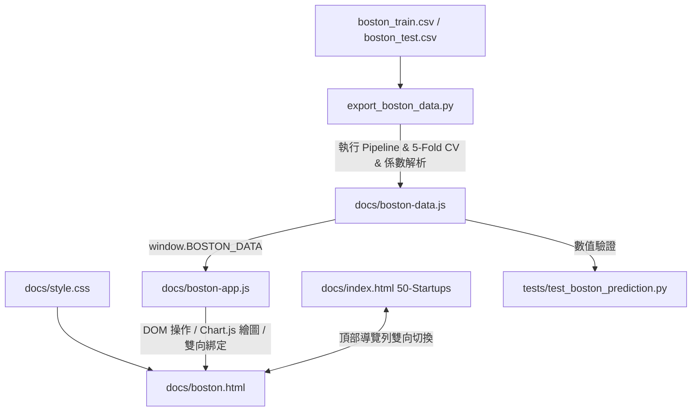

# 實作計畫：波士頓房價多元線性迴歸探索與即時預測儀表板 (08-boston-housing-explorer)

> 前置需求依據：[REQUIREMENT.md](./REQUIREMENT.md)

## 1. 目標說明 (Goal Description)
落實 `REQUIREMENT.md` 之所有規格與決策，在 `docs/` 目錄下建立高質感、暗黑玻璃風格（Deep Slate Glassmorphism）的波士頓房價多元線性迴歸專業探索儀表板 (`docs/boston.html`)。提供：
1. **導覽雙向切換**：與現有 `50-Startups` 頁面在頂部導覽列無縫互通。
2. **多模型架構比較**：整合 4 大經典架構（全特徵 13、關鍵 5 特徵、核心 3 要素、單一房間數 rm）與 5-Fold 交叉驗證指標連動。
3. **特徵複雜度權衡**：循序特徵增加 (k=1~13) 雙軸折線圖，突顯最佳折衷點與奧坎剃刀原則。
4. **即時雙向預測試算器**：支援 5 大核心預設 + 展開 13 項全特徵、依模型動態反灰停用無關特徵、4 組典型社區情境按鈕與範圍防呆 Clamp。
5. **殘差診斷與推論展示**：67 筆獨立測試集殘差診斷表（可排序）與 173 筆真實無標籤測試集批次預測預覽。

---

## 2. 系統架構與技術選型 (Architecture & Design)

### 2.1 整體架構與資料流向 (Data Flow)

### 2.2 模組職責劃分
- **資料產生模組 (`export_boston_data.py`)**：
  - 嚴格比照 Notebook 80/20 切分與標準化流程，計算 4 組模型架構、k=1~13 複雜度序列、67 筆測試集殘差、173 筆無標籤推論與特徵統計分佈。
  - 將標準化係數反算為原始尺度係數（Unstandardized Coefficients），讓前端純 JavaScript 預測引擎達到微秒級運算且 100% 吻合 scikit-learn Pipeline。
- **資料儲存層 (`docs/boston-data.js`)**：
  - 封裝全域物件 `window.BOSTON_DATA`，免除 CORS 限制，本機直接雙擊 HTML 即可流暢運行。
- **介面表現層 (`docs/boston.html` & `docs/style.css`)**：
  - 採用一致的暗黑琉璃風格（CSS Backdrop-filter、微光邊框、自訂 Range Thumb 滑桿）。
  - 新增「手風琴特徵展開器」、「未選取特徵反灰遮罩」與「雙尺度預測卡（$k 與 $USD）」。
- **互動控制層 (`docs/boston-app.js`)**：
  - 統一事件監聽、雙向 Input/Slider 同步、數值 Clamp、模型切換、情境載入與診斷表格分頁/排序。
- **品質檢驗層 (`tests/test_boston_prediction.py`)**：
  - 以 pytest 驗證前端 JS 預測公式與 Python Pipeline 數值完全一致（容許誤差 < 0.01 美元）。

---

## 3. 需使用者審閱事項 (User Review Required)

> [!IMPORTANT]
> **多頁面切換機制**：本計畫採獨立 `docs/boston.html` 頁面，並在現有 `docs/index.html` (50-Startups) 導覽列左上方新增雙專案切換按鈕。此改動對既有 50-Startups 頁面功能完全零破壞，能維持單一頁面的清晰職責。

> [!TIP]
> **即時預測器 13 項特徵體驗優化**：預設僅展開最重要的 5 大特徵（rm, lstat, ptratio, tax, crim），並提供「展開其餘 8 項特徵」按鈕。當切換為「房價核心 3 要素」模型時，不屬於該模型的特徵卡會自動反灰並標示「Not in Model」，直觀易懂。

---

## 4. 檔案異動清單 (Proposed Changes)

### `[NEW] src/ai_infosec_dic2/boston-housing-linearregression/export_boston_data.py`
- 讀取 `boston_train.csv` 與 `boston_test.csv`。
- 透過 scikit-learn 計算 4 組模型指標（Train/Test RMSE, MAE, R², Adj R², 5-Fold CV）、未標準化與標準化迴歸係數、k=1~13 複雜度數據、67 筆殘差診斷與 173 筆推論結果。
- 導出精美格式化之 `docs/boston-data.js`。

### `[NEW] docs/boston-data.js`
- 包含 `metadata`、`kpi`、`architectures` (4組)、`complexitySeries` (k=1~13)、`correlations` (13項)、`presets` (4組典型社區)、`featureRanges` (13項 min/max/step/mean/unit)、`testSetResiduals` (67筆) 與 `unlabeledPredictions` (173筆)。

### `[NEW] docs/boston.html`
- 依據需求規格書建立完整波士頓房價探索儀表板結構。
- 包含頂部切換導覽列、Hero 區、4 大架構切換卡、k=1~13 複雜度與最優解圖表區、即時雙向預測試算器（含 4 組情境按鈕與動態反灰）、測試集殘差診斷與無標籤推論分頁表格。

### `[NEW] docs/boston-app.js`
- 封裝波士頓儀表板互動邏輯：
  - `initArchitectureSelector()`: 切換 4 組架構並連動指標與迴歸方程式。
  - `initComplexityChart()`: 渲染 k=1~13 RMSE 與 R² 雙曲線圖並支援 k 標籤互動。
  - `initPredictorModule()`: 處理雙向綁定、Clamp 防呆、情境預設載入、反灰停用狀態與即時千美元/美元換算。
  - `initDiagnosticsTable()`: 處理殘差診斷表排序與 173 筆無標籤測試集切換。

### `[MODIFY] docs/style.css`
- 新增波士頓房價專屬樣式元件：
  - 專案導覽列切換開關 (`.project-switcher`)
  - 13 特徵進階展開摺疊區塊 (`.features-collapse`)
  - 預測特徵卡禁用反灰狀態 (`.feature-card.disabled`)
  - 雙尺度貨幣徽章與離群診斷狀態標籤

### `[MODIFY] docs/index.html`
- 於頂部導覽列新增專案切換標籤：加入「🏡 Boston Housing」連結至 `boston.html`，並將既有 50-Startups 標註為當前活動中項目。

### `[NEW] tests/test_boston_prediction.py`
- 驗證 `docs/boston-data.js` 的完整性。
- 驗證 4 大模型與 k 階模型在 Python Pipeline 預測值與前端 OLS 係數計算結果完全一致。

---

## 5. 驗證與測試計畫 (Verification Plan)

### 5.1 自動化測試指令
- 執行專屬測試：`pytest tests/test_boston_prediction.py -v`
- 執行全專案既有測試套件：`pytest tests/ -v`
- 前端 JS 語法與載入驗證：`node --check docs/boston-data.js` 與 `node --check docs/boston-app.js`

### 5.2 端到端人工與瀏覽器驗證
1. **導覽雙向切換**：點擊 50-Startups 頂部「🏡 Boston Housing」可流暢跳轉至 `boston.html`；點擊波士頓頂部「🏢 50 Startups」可回到首頁。
2. **模型架構連動**：切換 4 大模型，確認 5 大指標卡、方程式與預測器特徵卡反灰狀態即時更新。
3. **即時預測與 Clamp**：拖曳房間數 `rm` 滑桿，確認預測房價即時變動；點擊情境按鈕（如郊區豪宅）確認數值即時平滑填入。
4. **殘差診斷表**：點擊欄位標題確認可由高至低排序殘差；切換至「無標籤測試集」確認 173 筆預測數據分頁正常呈現。
